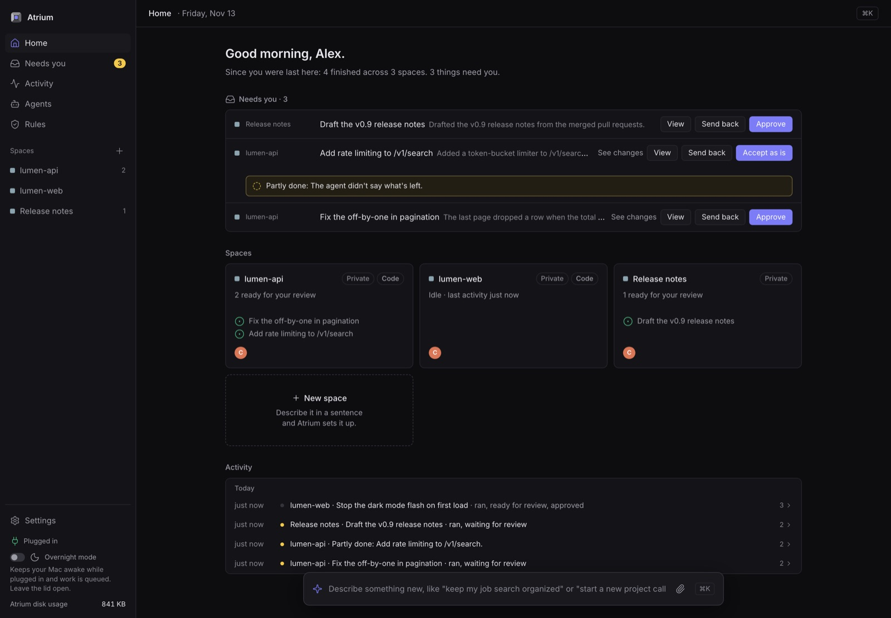
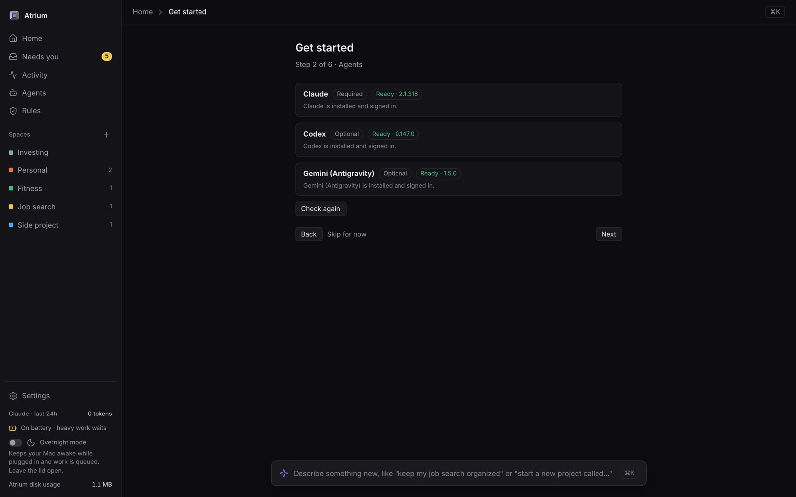

# Atrium

An agent workbench for coding, on your Mac.

The job has moved from writing code to directing agents and judging what they wrote. Atrium is where that happens: you say what you want, an agent writes it on its own branch, you watch and steer, and nothing lands until you say yes. Everything runs on your Mac, on your own Claude subscription.

Site: <https://nakulpatel0306.github.io/atrium/>



## What works today

- **Code spaces.** Point a space at a repo on your Mac or on GitHub. Every task runs on its own `atrium/<taskId>` branch, and Atrium never checks out over your uncommitted changes.
- **Live diff and steer.** Watch the diff grow while the agent works, and send it a note to change course without starting over.
- **Pull requests.** Approve the work and Atrium pushes the branch and opens the PR. Starting a new project creates the GitHub repo too. Both wait for your yes.
- **Attachments.** Drop files or screenshots into the ask bar and the agent works from them.
- **Approvals.** Everything that needs you waits in **Needs you**, with the agent's own word on how it went: done, partly done or couldn't. Rules can approve kinds of work you keep approving; pushes, merges, deploys, deletes and anything that costs money always ask.
- **Claude, Codex and Gemini.** Claude runs on your subscription through the Claude Code CLI. Add Codex or Gemini and Atrium routes code work between them, or you pick one per task.
- **Sandboxing.** Agents can't read your keys, `.env` files or passwords, can't reach Atrium's own API, and can't drive other apps.
- **General spaces** for the work around the code: notes, release drafts and docs, as files in a folder you can open in Finder.

## How it works: the loop

Every coding task runs the same loop: **brief → write → verify → review → you.**

- **Brief.** Press Enter and the task starts. Its first stage is a quick, read-only pass that turns your one-liner into a brief: the goal, acceptance criteria, scope and files to look at first, shown on the task. If the ask is really ambiguous it asks at most two questions, answered with a tap in **Needs you**. ⌘↩ shows the brief first, to edit before it runs.
- **Write.** The agent works on its own branch, with the brief as its task spec.
- **Verify.** Atrium finds your typecheck, lint and test commands (package.json, Makefile, pyproject, Cargo, go.mod, CLAUDE.md/AGENTS.md, or your own list) and runs them itself after every turn, sandboxed, in a checkout of their own that never touches yours. Failures go back to the agent. The agent's own "tests pass" never counts, and a check that couldn't run is never "passed".
- **Review.** A fresh session reads only the diff and the brief, from another vendor when one is installed and allowed in the space, else a new Claude session. The writer fixes or answers each finding, for at most two rounds.
- **You.** Then the work waits in **Needs you**, with the checks, the findings and how each was resolved, and plainly labelled when the checks couldn't prove anything or the review didn't happen. Anything the change did to the checks themselves (edited their config, dropped or skipped tests, silenced a checker) is called out, and no rule approves it for you.

Each task has a token and time budget. An agent that repeats itself or stops making progress is paused with a one-line diagnosis: give it a hint, or ask it to explain the problem. The details, and what the checks can and can't prove, are in [docs/loop.md](docs/loop.md).

## The right shape, cheaper

One writer is the default, because more agents make most coding worse. The brief's pre-pass also suggests how the task should run, with a one-line reason on the task ("Single writer: sequential change in one module") and a one-click change while it hasn't started:

- **Single writer**, for sequential or single-module work.
- **Scouts, then one writer**, when the work first needs broad reading. Claude's own subagents do the reading, read-only on a cheap model, and hand the writer short answers instead of everything they read.
- **Split into tasks**, for independent parts with their own files. Each part runs the whole loop as a task of its own, on its own branch; then you open their pull requests or merge them into one branch, which Atrium checks and reviews again.
- **Best of N**, for uncertain work the repo's checks can judge. Two or three attempts run on their own branches; any that fail the checks are dropped, a strong model scores the rest against the brief, and you pick one.

Splits and best-of-N cost more, so they run only on your yes, with an estimate first. Claude runs on three tiers you can change under Agents: a cheap model for briefs, scouts and explanations, your own model for writing, and a strong one for review, a writer you had to unstick, and judging attempts. Every task shows its weighted tokens and an estimate at list prices, each space shows today and this week, and the five-hour gauge says what Atrium ran in the window and what it can't see. A writer's next turn within the prompt cache's five minutes resumes its Claude session, so most of its context comes from the cache; a long one starts afresh with a progress note.

## Screenshots

All screenshots come from a throwaway engine with fake agents and made-up repos.

| | |
|---|---|
|  | |
| **Get started** checks your agents and walks you through setup. | |

## Requirements

- A Mac with Apple silicon, macOS 14 or later
- [bun](https://bun.sh)
- Xcode command line tools (`xcode-select --install`), needed to build the Mac app
- The [Claude Code](https://claude.com/claude-code) CLI, signed in to your Claude account (a subscription; no API key)
- Optional: `codex` (Codex CLI), `agy` (Antigravity, for Gemini) and `gh` (GitHub CLI, for code spaces)

## Install

```sh
git clone https://github.com/nakulpatel0306/atrium.git
cd atrium
bun install
bun link             # puts `atrium` on your PATH
atrium install       # starts Atrium now and at every login
atrium app install   # adds Atrium.app to ~/Applications
```

Don't move or delete the folder after `atrium install`: the login service points at it. To move it, run `atrium uninstall`, move it, and install again.

## First run

Open the app (or run `atrium open`). On a fresh install, **Get started** walks you through five short steps: a welcome, your agents (Claude Code is required, Codex and Gemini are optional), the GitHub CLI, your name and projects folder, and Done. You can skip everything except Claude and come back from **Settings → Get started**.

From a terminal, `atrium doctor` shows the same checks, with the install and sign-in command for anything missing.

## Privacy and safety

- Your data stays on your Mac. The database, transcripts and space files are under your data folder (`atrium data` lists them with sizes). This repository contains no personal data.
- Upgrading from a version with mail, texting, money or investing? Those features are gone, but their data may still be in the database, along with sign-in tokens and market-data keys in your login Keychain (service `Atrium`). Home and **Settings → Data** offer **Remove old data**, and so does `atrium data remove-old`. Both show exactly what will go and remove nothing until you confirm.
- To remove all personal data, run `atrium uninstall`, quit Atrium, then delete `~/Library/Application Support/Atrium` and `~/Atrium`.
- Agents run in a sandbox: they can't read your passwords or keys, can't control other apps, and can't change Atrium itself.
- Only Atrium pushes code or creates repos, and only after you approve. Private spaces only use Claude.
- Archive a space to hide it, or delete it for good by typing its name. Deleted folders go to the Trash.

## Known limits

- macOS only.
- An older database keeps the tables of features that were removed (investing, money, mail and calendar, texting) until you remove them (see Privacy and safety). Atrium reads them only to list them for removal; spaces of those kinds show as plain private spaces.

## For developers

```sh
bun test ./tests/engine   # run tests in groups: engine, server, dashboard,
bun test ./tests/server   # e2e, tui, mac, copy, cli.test.ts, main.test.ts
bunx tsc --noEmit
bun run leak-check
ATRIUM_DEV=1 ATRIUM_HOME=$(mktemp -d) ATRIUM_PORT=7421 bun src/main.ts
```

See [CONTRIBUTING notes in CLAUDE.md](CLAUDE.md) and the [docs](docs/README.md). Screenshots go in `docs/screenshots/`.

## License

[MIT](LICENSE)
