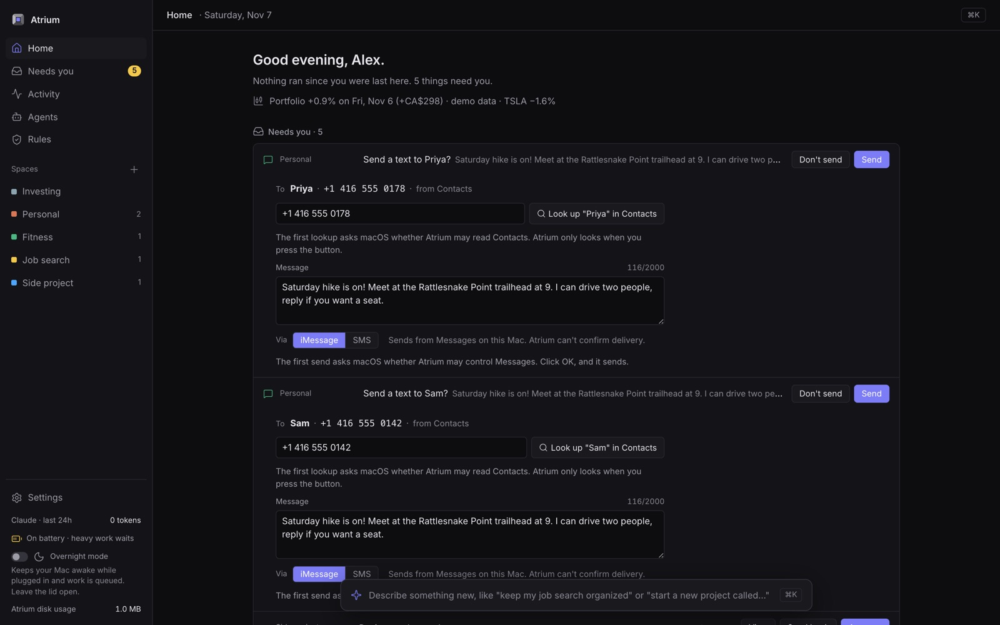
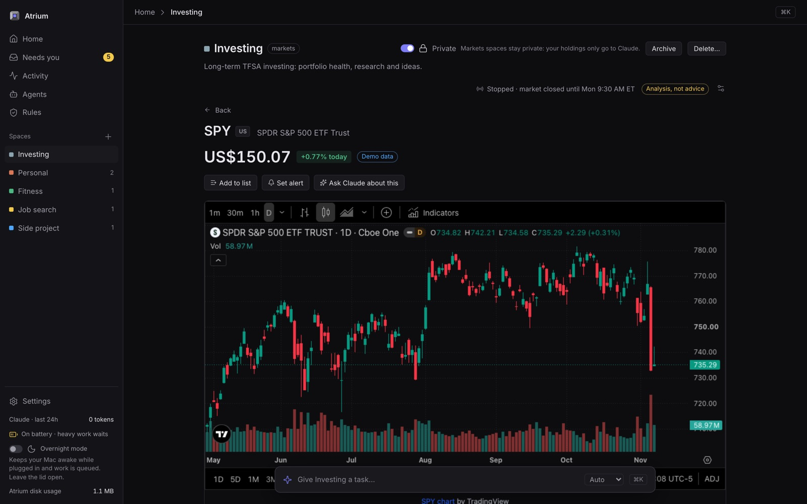
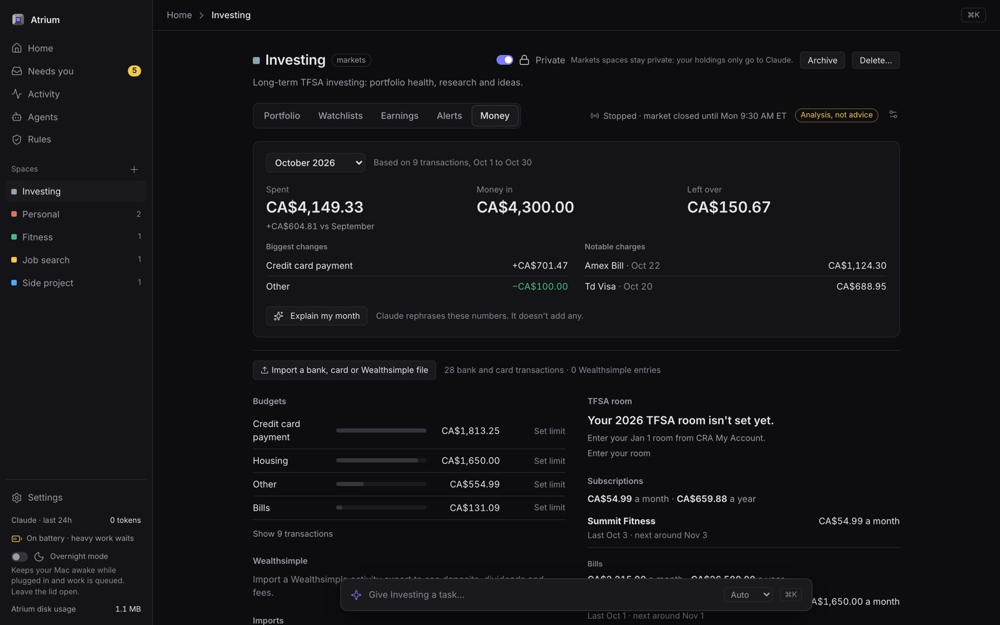

# Atrium

A calm command center for your AI agents, on your Mac.

You tell Atrium what you want in plain words. It hands the job to an AI agent, shows you what came back, and waits for your yes before anything counts. Code, errands, texts, investing and money live in one place. Everything runs on your Mac.

Site: <https://nakulpatel0306.github.io/atrium/>


## What it does

- **Everyday life and work.** Ask for a grocery list, a packing plan or a study guide. You get a file you can open in Finder.
- **Texts.** "Text Sam and Priya to lock in Saturday's hike" writes the message and finds each number in your Contacts, or sends to an existing group chat. Nothing is sent until you press Send.
- **Code.** Point it at a repo and ask for a fix or a review. Agents work on their own branch, and you review every change. Starting a new project creates the GitHub repo too, after you say yes.
- **Investing.** Your portfolio in Canadian dollars, a page for any stock or ETF, watchlists, alerts, and questions answered from your own holdings. It's analysis, not advice.
- **Money.** Import a bank or card CSV monthly to see spending by category, recurring charges and anything unusual.

Work is organized into **spaces**. Each space has **tasks**, and each task goes to an agent: Claude on your Claude subscription, or Codex and Gemini for some code work. Anything that needs you waits in **Needs you**.

## Screenshots

All screenshots use made-up data.

| | |
|---|---|
|  |  |
| **Texts** wait for your Send and show exactly who they go to. | **Investing**: any stock or ETF gets a chart, alerts and answers from your own holdings. |
|  |  |
| **Money**: import a bank CSV to see the month, budgets and subscriptions. | **Get started** checks your agents and walks you through setup. |

## Requirements

- A Mac with Apple silicon, macOS 14 or later
- [bun](https://bun.sh)
- Xcode command line tools (`xcode-select --install`), needed to build the Mac app
- The [Claude Code](https://claude.com/claude-code) CLI, signed in to your Claude account (a subscription; no API key)
- Optional: `codex` (Codex CLI), `agy` (Antigravity, for Gemini) and `gh` (GitHub CLI, for code spaces)

## Install

```sh
git clone https://github.com/nakulpatel0306/atrium.git
cd atrium
bun install
bun link             # puts `atrium` on your PATH
atrium install       # starts Atrium now and at every login
atrium app install   # adds Atrium.app to ~/Applications
```

Don't move or delete the folder after `atrium install`: the login service points at it. To move it, run `atrium uninstall`, move it, and install again.

## First run

Open the app (or run `atrium open`). On a fresh install, **Get started** walks you through it: your agents (Claude Code is required, Codex and Gemini are optional), the GitHub CLI, the Contacts and Messages permissions macOS asks for on first use, investing and money, and your name and projects folder. You can skip everything except Claude and come back from **Settings → Get started**.

From a terminal, `atrium doctor` shows the same checks, with the install and sign-in command for anything missing.

## Investing and money

Run **Set up investing** in Get started (or `atrium investing setup`) to create an empty, private Investing space. Add free market-data keys in **Settings → Market data**: Finnhub (required for live US prices and search) and optionally Alpha Vantage. Keys are stored in your Mac's Keychain. Then import a Wealthsimple holdings report, or add tickers yourself.

For money, open the Investing space's Money tab and import a CSV each month. TD, Amex and Wealthsimple files are recognised; most other bank exports work through a column mapper. Add your own accounts there by name, kind and institution. Card and account numbers are masked before anything is saved.

## Privacy and safety

- Your data stays on your Mac. The database, transcripts and space files are under your data folder (`atrium data` lists them with sizes). Keys are in the Keychain. This repository contains no personal data.
- To remove all personal data, run `atrium uninstall`, quit Atrium, then delete `~/Library/Application Support/Atrium`, `~/Atrium` and the Atrium items in Keychain Access.
- Agents run in a sandbox: they can't read your passwords or keys, can't control other apps, and can't change Atrium itself.
- Only Atrium sends texts or creates repos, and only after you approve. Private spaces like Investing only use Claude, and market-data services only see ticker symbols.
- Archive a space to hide it, or delete it for good by typing its name. Deleted folders go to the Trash.

## Known limits

- Amounts are in Canadian dollars (CAD) only. Home currency shows in Settings but can't be changed yet, and US holdings are converted to CAD.
- TSX prices during the day come from Yahoo Finance's unofficial public feed. Alpha Vantage supplies official closes.
- Recognised bank formats are TD, Amex and Wealthsimple. Others use the column mapper.
- The TFSA room card applies to Canadian tax-free accounts.
- macOS only.

## For developers

```sh
bun test ./tests/engine   # run tests in groups: engine, server, dashboard,
bun test ./tests/server   # e2e, tui, mac, copy, cli.test.ts, main.test.ts
bunx tsc --noEmit
bun run leak-check
ATRIUM_DEV=1 ATRIUM_HOME=$(mktemp -d) ATRIUM_PORT=7421 bun src/main.ts
```

See [CONTRIBUTING notes in CLAUDE.md](CLAUDE.md) and the [docs](docs/README.md). Screenshots go in `docs/screenshots/`.

## License

[MIT](LICENSE)
