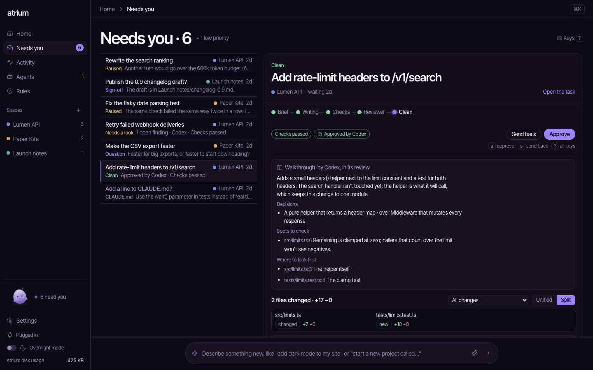
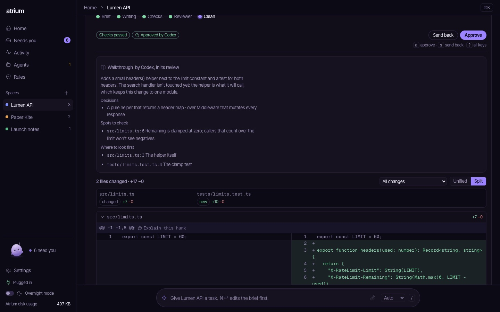
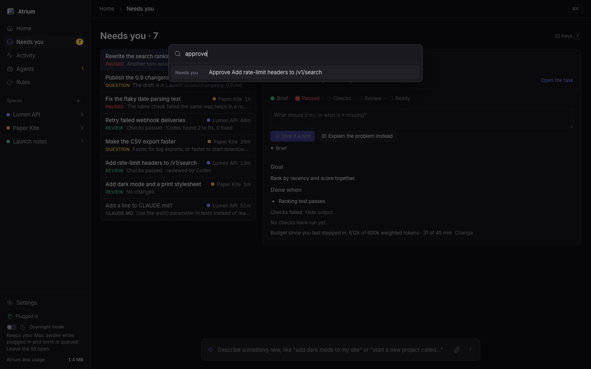
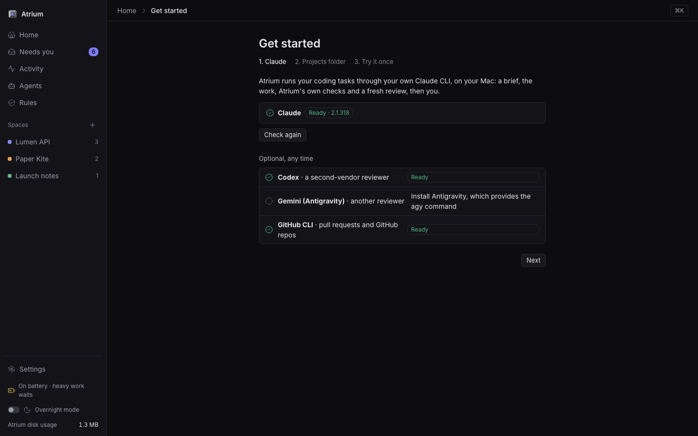
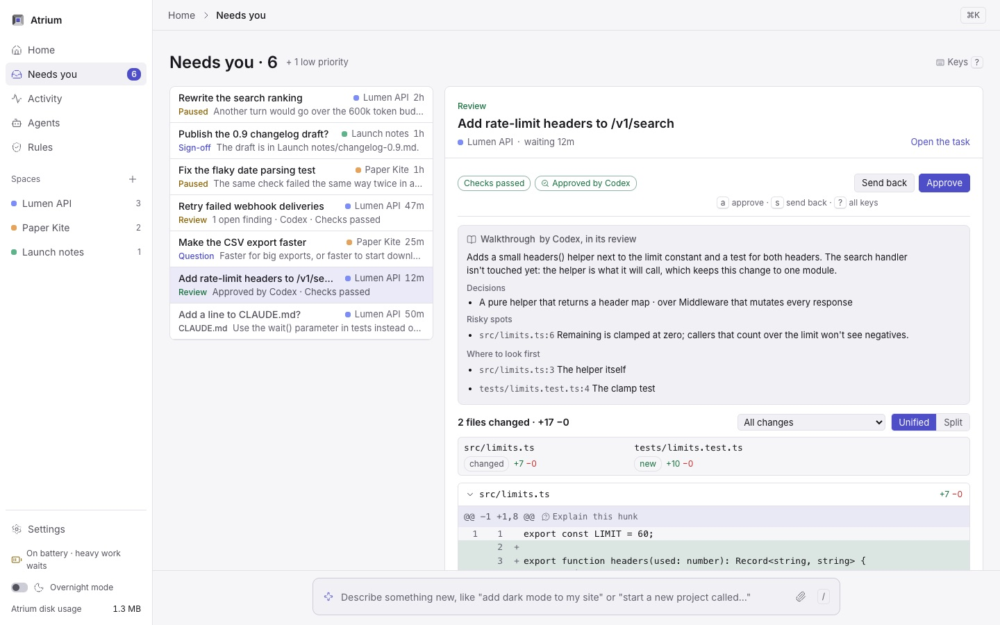

# Atrium

The agent workbench for the new way of coding, on your Mac.

The job has moved from writing code to directing agents and judging what they wrote. Most tools stop at running agents: a branch per task, a live diff, a PR button. Atrium is about the part that decides whether agent work is any good. Every task gets a brief an agent can finish, Atrium runs your checks itself instead of trusting "tests pass", a fresh reviewer reads the diff before you do, and everything that needs you lands in one keyboard-first queue. Along the way it helps you get better at directing agents, with feedback built only from what it measured. It runs on your Mac, on your own Claude subscription, with only the Claude CLI and a folder.

Site: <https://nakulpatel0306.github.io/atrium/> · Why it works this way: [docs/why.md](docs/why.md)



## Quickstart

```sh
git clone https://github.com/nakulpatel0306/atrium.git && cd atrium
bun install && bun link
atrium install && atrium open
```

Get started checks your Claude CLI (with the install command if it's missing), asks for your projects folder, and offers a sample task: a tiny bundled repo with one failing test, copied into Atrium's own folder, fixed by your Claude CLI on its cheapest model while you watch the whole loop. It takes about a minute and costs around 2¢ at list prices. Skip it if you'd rather start on your own repo.

## What Atrium does differently

- **The loop, every time.** Brief → write → verify → review → you. The engine runs the repo's own checks after every turn in a sandboxed checkout of their own, and a clean-context reviewer judges mergeability against the brief. Results that couldn't be proven are labelled as such. In published studies, about 44% of agent failures trace to the spec and 24% to verification, and about half of agent PRs that passed a benchmark's tests still weren't mergeable.
- **The right shape, cheaper.** One writer by default, read-only scouts for broad reading, a split or best-of-N only on your click. A cheap model drafts briefs and explanations, a strong one reviews, sessions stay warm in the prompt cache, and every task shows its tokens and a list-price estimate. Controlled studies found multi-agent setups lose 39–70% on sequential work.
- **Learning, both kinds.** A walkthrough on every result, "explain this hunk" on any change, the diagnosis first when an agent is stuck, and a director retro built only from measured numbers. Developers who asked for explanations after generating code scored 86% on a follow-up quiz against 39% for pure delegation. Nothing here is a gate.
- **One queue for everything that needs you.** Approvals, questions, pauses and proposals, longest-blocked first, each opening to one screen with the walkthrough, the diff, the brief, checks and findings. j/k to move, a to approve (twice when something is open), s to send back, Shift-A to approve every clean result at once at the commit you saw, and a minute to take an approval back. The terminal app and the Mac app's badge read the same queue.

## What works today

- **Code spaces.** Point a space at a repo on your Mac or on GitHub. Every task runs on its own `atrium/<taskId>` branch, and Atrium never checks out over your uncommitted changes.
- **Live diff and steer.** Watch the diff grow while the agent works, and send it a note to change course without starting over. Finished work shows each turn's commit on its own, unified or side by side.
- **Pull requests.** After you approve, one more click pushes the branch and opens the PR. Starting a new project creates the GitHub repo too. Both wait for your yes.
- **Rules.** When you keep approving one kind of result unchanged, Atrium suggests approving it on its own; you can undo any of those approvals. Pushes, merges, deploys, deletes and anything that costs money always ask.
- **⌘K for everything.** Every action by name: a new task, any space or task, approving a clean result, switching a task's shape, the learning dial, the theme.
- **Light and dark**, following your Mac unless you pick one; keyboard everywhere, visible focus, AA contrast in both, and reduced motion respected.
- **Claude, Codex and Gemini.** Claude runs on your subscription through the Claude Code CLI. Add Codex or Gemini and Atrium can use them as writers or as a second-vendor reviewer.
- **Sandboxing.** Agents can't read your keys, `.env` files or passwords, can't reach Atrium's own API, and can't drive other apps. Only Atrium pushes, and only after your yes.
- **General spaces** for the work around the code: notes, release drafts and docs, as files in a folder you can open in Finder.

## How it works: the loop

Every coding task runs the same loop: **brief → write → verify → review → you.**

- **Brief.** Press Enter and the task starts. Its first stage is a quick, read-only pass that turns your one-liner into a brief: the goal, acceptance criteria, scope and files to look at first, shown on the task. If the ask is really ambiguous it asks at most two questions, answered with a tap in **Needs you**. ⌘↩ shows the brief first, to edit before it runs.
- **Write.** The agent works on its own branch, with the brief as its task spec.
- **Verify.** Atrium finds your typecheck, lint and test commands (package.json, Makefile, pyproject, Cargo, go.mod, CLAUDE.md/AGENTS.md, or your own list) and runs them itself after every turn, sandboxed, in a checkout of their own that never touches yours. Failures go back to the agent. The agent's own "tests pass" never counts, and a check that couldn't run is never "passed".
- **Review.** A fresh session reads only the diff and the brief, from another vendor when one is installed and allowed in the space, else a new Claude session. The writer fixes or answers each finding, for at most two rounds.
- **You.** Then the work waits in **Needs you**, with the checks, the findings and how each was resolved, and plainly labelled when the checks couldn't prove anything or the review didn't happen. Anything the change did to the checks themselves (edited their config, dropped or skipped tests, silenced a checker) is called out, and no rule approves it for you.

Each task has a token and time budget. An agent that repeats itself or stops making progress is paused with a one-line diagnosis: give it a hint, or ask it to explain the problem. The details, and what the checks can and can't prove, are in [docs/loop.md](docs/loop.md).

## The right shape, cheaper

One writer is the default, because more agents make most coding worse. The brief's pre-pass also suggests how the task should run, with a one-line reason on the task ("Single writer: sequential change in one module") and a one-click change while it hasn't started (a costlier shape can still be taken until review):

- **Single writer**, for sequential or single-module work.
- **Scouts, then one writer**, when the work first needs broad reading. Read-only scout sessions on a cheap model do the reading and hand the writer short answers instead of everything they read.
- **Split into tasks**, for independent parts with their own files. Each part runs the whole loop as a task of its own, on its own branch; then you open their pull requests or merge them into one branch, which Atrium checks and reviews again.
- **Best of N**, for uncertain work the repo's checks can judge. Two or three attempts run on their own branches; any that fail the checks are dropped, a strong model scores the rest against the brief, and you pick one.

Splits and best-of-N cost more, so they run only on your click. Enter never waits for it: a task the pre-pass would split runs as one writer, with "Could run as 2 parts (est. ~$0.04) · Split instead" on it, and the click starts it over from the brief as the parts. Claude runs on three tiers you can change under Agents: a cheap model for briefs, scouts and explanations, your own model for writing, and a strong one for review, a writer you had to unstick, and judging attempts. Every task shows its weighted tokens and an estimate at list prices, each space shows today and this week, and the five-hour gauge says what Atrium ran in the window and what it can't see. A writer's next turn within the hour Claude Code keeps its prompt cache resumes its Claude session, so most of its context comes from the cache; a long one starts afresh with a progress note.

## Learning, both kinds

Directing agents is a skill, and so is understanding the code they write. Atrium helps with both, and all of it is optional: nothing is a quiz or a gate, and nothing adds a step before the result reaches you. Each code space has a learning dial in its settings: **Off**, **Light** (the default) or **Deep**.

- **Walkthrough.** Every finished result carries a short walkthrough above its diff: the approach, the key decisions and what they passed over, risky spots, and where to look first, each a link that opens the Changes at that hunk. The reviewer writes it in the pass that already reads the diff; when it can't (review is off, or a later turn changed the branch), a cheap model writes it from the diff after the result is already waiting for you.
- **Explain this hunk.** On any hunk in the Changes view, a cheap, read-only model says why it's there and what it touches, not what each line does. Answers are kept, so asking again is instant.
- **Deep mode** adds one question before the walkthrough opens ("What does a 150% coupon do?"), answered with a click or skipped, and asks the writer to state its approach before it edits.
- **The diagnosis first.** When an agent is paused for failing the same way again, "Explain the problem" is offered first: another attempt at the same error is the slowest way to fix it.
- **Director retro.** After you accept a result or open its pull request, three lines built only from what Atrium measured: your steers, rework turns (failing checks and review rounds), checks that broke late, and the cost against your median for similar earlier tasks in the space, with one suggestion picked by fixed rules ("2 rework turns came from failing checks and the brief had no acceptance criteria: add them next time"). Each space and Home show what paid off this week, once there are five finished tasks to compare.
- **Project memory.** When you steer with what reads as a correction ("don't…", "use X instead"), or the reviewer flags the same kind of mismatch twice, Atrium proposes one line for the repo's CLAUDE.md. You see the exact text, edit it, and only your click commits it, as a bullet under one "Notes from Atrium" section, on the task's branch or a small branch of its own. The space shows CLAUDE.md's length against a 200-line budget. Atrium never writes the file wholesale.

## Screenshots

All screenshots come from a throwaway engine with fake agents and made-up repos.

| | |
|---|---|
|  |  |
| **Changes**: all of a task's changes or one turn's, unified or split. | **⌘K**: every action by name. |
|  |  |
| **Get started**: Claude, a folder, and the loop once on a demo repo. | **Light theme**, from your Mac's setting or ⌘K. |

## Requirements

- A Mac with Apple silicon, macOS 14 or later
- [bun](https://bun.sh)
- Xcode command line tools (`xcode-select --install`), needed to build the Mac app
- The [Claude Code](https://claude.com/claude-code) CLI, signed in to your Claude account (a subscription; no API key)
- Optional: `codex` (Codex CLI), `agy` (Antigravity, for Gemini) and `gh` (GitHub CLI, for code spaces)

## Install

```sh
git clone https://github.com/nakulpatel0306/atrium.git
cd atrium
bun install
bun link             # puts `atrium` on your PATH
atrium install       # starts Atrium now and at every login
atrium app install   # optional: adds Atrium.app to ~/Applications
```

Don't move or delete the folder after `atrium install`: the login service points at it. To move it, run `atrium uninstall`, move it, and install again.

## First run

Open the app (or run `atrium open`). On a fresh install, **Get started** has three steps: Claude (required; Codex, Gemini and the GitHub CLI are listed as optional, with their install commands), your projects folder (prefilled), and the sample task, which you can skip. Come back to it from **Settings → Get started**.

From a terminal, `atrium doctor` shows the same checks in the same order, with the install and sign-in command for anything missing.

## Privacy and safety

- Your data stays on your Mac. The database, transcripts and space files are under your data folder (`atrium data` lists them with sizes). This repository contains no personal data.
- Upgrading from a version with mail, texting, money or investing? Those features are gone, but their data may still be in the database, along with sign-in tokens and market-data keys in your login Keychain (service `Atrium`). Home and **Settings → Data** offer **Remove old data**, and so does `atrium data remove-old`. Both show exactly what will go and remove nothing until you confirm.
- To remove all personal data, run `atrium uninstall`, quit Atrium, then delete `~/Library/Application Support/Atrium` and `~/Atrium`.
- Agents run in a sandbox: they can't read your passwords or keys, can't control other apps, and can't change Atrium itself.
- Only Atrium pushes code or creates repos, and only after you approve. Private spaces only use Claude.
- Archive a space to hide it, or delete it for good by typing its name. Deleted folders go to the Trash.

## Known limits

- macOS only, Apple silicon.
- Checks are evidence, not proof: the writer can still weaken a test's assertion without skipping or deleting it. The reviewer and you see the diff. [docs/loop.md](docs/loop.md) lists every known way a change can alter what its checks mean, and which stay open.
- Codex's subagents can't be switched off completely in codex-cli 0.147; they run inside the same sandbox as the writer.
- Atrium sees Claude's five-hour window only when a run reports it, so use in other Claude apps shows up at Atrium's next run.
- The sample task's space stays in the sidebar until you delete the task or the space, which removes its copy of the demo repo too.
- An older database keeps the tables of features that were removed (investing, money, mail and calendar, texting) until you remove them (see Privacy and safety).

## For developers

See [CONTRIBUTING.md](CONTRIBUTING.md): running a dev engine beside your own, the test groups, the copy rules and the leak check. [docs/architecture.md](docs/architecture.md) shows how the engine, the dashboard, the terminal app and the Mac app fit together, and [docs/loop.md](docs/loop.md) is the reference for how a task runs.

## License

[MIT](LICENSE)
